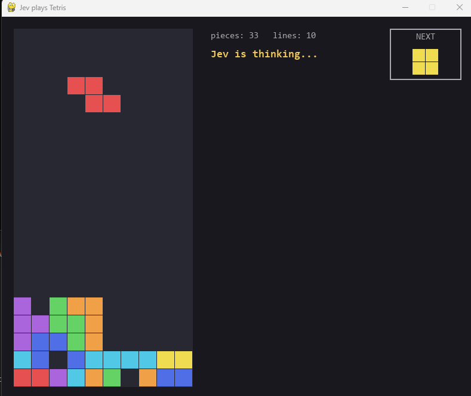

# Jev plays Tetris

Tetris where **Jev (System 1)** picks every move. The window shows Jev's probability for
each candidate placement, so you can see what it considers and what it chooses.

## Example



## How it works

For each piece the code lists **all** placements (rotation + column) and sends them to Jev
as one `choice` question. Jev gets:

- the board as an ASCII grid, column heights and the current number of holes;
- the current piece and the **next piece**;
- a text description of every placement: lines cleared, change in holes, max height,
  bumpiness, almost-full rows, deep wells, and the best case for the next piece
  (lines it could clear, holes it would add).

Jev returns a probability for every placement (they add up to 100%); the code plays the
most likely one. There is no formula that pre-selects moves.

If the API fails, the game plays a random placement and shows the error.

## Window

- Left: the board. Right: pieces and lines counters, Jev's response time and confidence,
  and the placements with a probability above 0% (the rest are summed up in one line).
- The next piece is shown in a frame in the top right corner.
- The piece starts falling at once. While Jev thinks it drifts down; when the answer
  arrives it rotates and slides to the chosen spot, then drops.

## Run

1. Put your key into the `.env` file next to the script: `TYPESAFE_API_KEY=your_key`
   (or set the `TYPESAFE_API_KEY` environment variable instead).
2. Install and start (on Windows just run `start.bat`):
```
pip install -r requirements.txt
python tetris_jev.py
```
Keys: `R` restart (resets the piece counter), `ESC` quit.

## Settings

Constants at the top of `tetris_jev.py`: `MAX_PIECES` and the animation speeds
`THINK_SPEED`, `STEER_SPEED`, `STEP_TIME`, `DROP_SPEED`.

